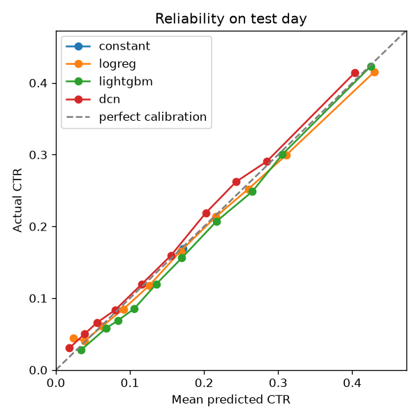
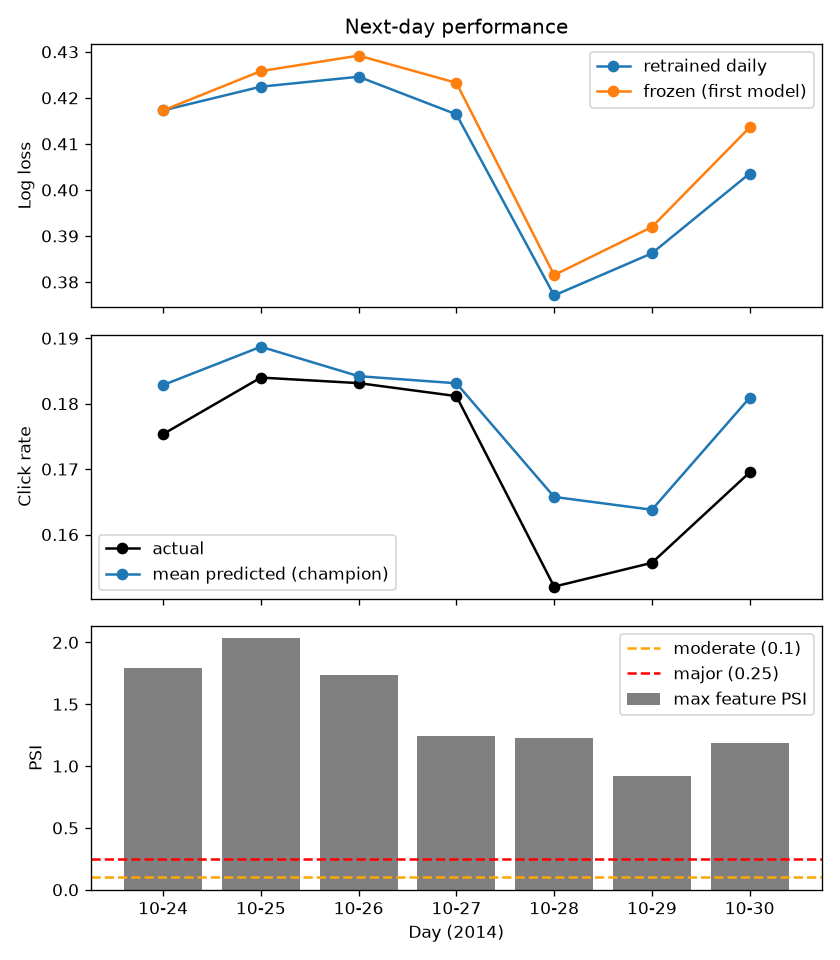

# CTR Prediction Pipeline

An end-to-end click-through-rate (CTR) prediction system built on public ad data. It covers the whole lifecycle, not just the model: time-aware evaluation, a served prediction API, scheduled retraining with Airflow, and monitoring for drift.

> 🚧 **Work in progress.** Phases 0–4 are done: the best model, DCN-v2, reaches a test AUC of 0.737 and normalised entropy of 0.878 (see [model comparison](#model-comparison-phase-2)), the prediction API answers in under 5 ms at the median (see [serving](#serving-phase-3)), and an Airflow DAG retrains and monitors the model daily (see [phase 4](#daily-retraining-and-monitoring-phase-4)). See the [roadmap](#roadmap) for what's next.

## Why

In programmatic advertising, every bid starts with one question: *how likely is this impression to be clicked?* A CTR model has to be well calibrated, because its probabilities feed straight into bid prices. It also has to answer in a few milliseconds and keep up as traffic shifts from day to day. This project builds that system in the open, on public data.

## Data

[Avazu Click-Through Rate Prediction](https://www.kaggle.com/competitions/avazu-ctr-prediction): about 40M mobile ad impressions over 10 days (21–30 October 2014), with hourly timestamps and 21 anonymised categorical features.

Only the labelled `train.gz` file is used. It's split **by day, not at random**: days 1–8 train, day 9 validation, day 10 test. This matches production, where a model trained on the past is scored on the future.

## Roadmap

- [x] **0. Scaffold:** packaging with `uv`, lint, tests, CI on synthetic data, data download
- [x] **1. Baseline:** hashed logistic regression; log loss, AUC, normalised entropy and calibration
- [x] **2. Better models:** LightGBM and a deep CTR model (DCN-v2), calibration, MLflow tracking
- [x] **3. Serving:** FastAPI prediction service in Docker, with a latency benchmark *(cloud deployment not done yet)*
- [x] **4. Pipeline and monitoring:** Airflow DAG that replays the data day by day to retrain and evaluate, with drift checks
- [ ] **5. Bidding simulation:** turn predicted CTR into bids under a daily budget and compare clicks per £ with a flat bid
- [ ] **6. Write-up:** architecture diagram, results and lessons learned

## Quickstart

Requires [uv](https://docs.astral.sh/uv/) and Python 3.11+.

```bash
uv sync                  # install the package and dev tools
uv run pytest            # run tests on synthetic data, no download needed
uv run ruff check .      # lint
```

Get the real data (needs a Kaggle account, the competition rules accepted, and an API token in `~/.kaggle/kaggle.json`):

```bash
uv sync --extra data
uv run python scripts/download_avazu.py
```

## Baseline (phase 1)

```bash
uv run python -m ctr.train_baseline --data data/raw/train.gz
```

By default this samples 5% of rows (about 2M) from across all 10 days; `--sample-frac 1` uses everything. Every categorical value is one-hot encoded with the hashing trick into 2²⁰ columns, plus hour-of-day and day-of-week. The regularisation strength `C` is chosen on the validation day and results are reported on the test day, against a constant predictor that always outputs the training click rate. Output goes to `reports/baseline/`: `metrics.json`, `results.md` and a reliability plot.

**Metrics**

| Metric | What it measures | Good |
| --- | --- | --- |
| Log loss | Accuracy of the predicted probabilities | Lower |
| Normalised entropy | Log loss divided by the entropy of the training click rate ([He et al., 2014](https://research.facebook.com/publications/practical-lessons-from-predicting-clicks-on-ads-at-facebook/)). 1.0 = no better than the constant predictor | Lower |
| AUC | How well the model ranks clicks above non-clicks | Higher |
| Calibration ratio | Mean predicted CTR ÷ actual CTR | Close to 1 |
| ECE | Expected calibration error: average gap between predicted and actual CTR across 10 equal-count prediction bins | Lower |

Calibration matters because the predicted probability sets the bid price: a model that ranks well but predicts 2× the real CTR overbids on everything.

### Results

A 5% random sample of the Avazu train file (2,021,339 impressions): 1,618,782 to train on (21–28 October 2014), 191,306 to validate on (29 October) and 211,251 to test on (30 October). The test-day click rate is 16.95%.

| Model | Log loss | Normalised entropy | AUC | Calibration ratio | ECE |
| --- | ---: | ---: | ---: | ---: | ---: |
| Constant (training CTR, 17.16%) | 0.4551 | 0.993 | 0.500 | 1.013 | 0.0021 |
| Logistic regression, C = 0.1 | **0.4038** | **0.881** | **0.736** | 1.019 | 0.0077 |


- **Logistic regression cuts log loss by 11%** against always predicting the training click rate, and ranks clicks well above chance (AUC 0.736).
- **It's well calibrated**, which matters because predictions become bids. On average it predicts 1.9% more clicks than happen. It slightly over-predicts in the highest-CTR bin and under-predicts in the lowest.
- **The constant predictor's normalised entropy is 0.993, not 1.0**, because the click rate on the test day (16.95%) differs from training (17.16%). That gap is a small example of the day-to-day drift phase 4 will monitor.
- **C was chosen on the validation day.** Validation log loss: 0.3901 (C = 0.001), 0.3836 (0.01), **0.3814 (0.1)**, 0.3895 (1.0). Weaker regularisation overfits the long tail of rare IDs.

These numbers are not comparable with the Kaggle leaderboard, which scored a different, unlabelled test file.

Reproduce: `uv run python -m ctr.train_baseline --sample-frac 0.05 --seed 0`. It takes about 25 minutes on a laptop, mostly the C = 1 fit.

<br clear="right">

## Model comparison (phase 2)

```bash
uv run python -m ctr.train --data data/raw/train.gz      # all models, about 5 minutes
uv run mlflow ui --backend-store-uri sqlite:///mlflow.db  # browse the logged runs
```

Three models trained on the same split and sample as phase 1:

- **Logistic regression:** the phase 1 baseline, with C fixed at 0.1.
- **LightGBM:** inputs are how often each value appeared in training, plus category codes for each field's 100 most common values. Boosting stops when day-9 log loss stops improving.
- **DCN-v2** ([Wang et al., 2021](https://arxiv.org/abs/2008.13535)) in PyTorch: a 16-dimensional embedding per field value (values seen fewer than 5 times share one), 3 cross layers and a 256→128 MLP. Training stops when day-9 log loss stops improving, and the best epoch's weights are kept.

Each model also gets a **Platt-scaled** version, `sigmoid(a·logit(p) + b)` fitted on day 9. It changes the probabilities but not their order, so AUC is unchanged. Every run is logged to MLflow with its settings, metrics and timings.

### Results

Test day: 30 October 2014, 211,251 impressions, click rate 16.95%.

| Model | Log loss | Normalised entropy | AUC | Calibration ratio | ECE | Training time |
| --- | ---: | ---: | ---: | ---: | ---: | ---: |
| Constant | 0.45510 | 0.9926 | 0.5000 | 1.013 | 0.0021 | – |
| Logistic regression | 0.40379 | 0.8807 | 0.7360 | 1.019 | 0.0077 | 142 s |
| + Platt | 0.40400 | 0.8812 | 0.7360 | 0.951 | 0.0083 | |
| LightGBM (329 rounds) | 0.40357 | 0.8802 | 0.7365 | 1.067 | 0.0114 | 35 s |
| + Platt | 0.40306 | 0.8791 | 0.7365 | 0.990 | 0.0073 | |
| DCN-v2 (1 epoch) | 0.40272 | 0.8784 | 0.7369 | 0.942 | 0.0097 | 103 s |
| + Platt | **0.40243** | **0.8777** | **0.7369** | 0.954 | 0.0089 | |



- **The models are almost tied.** DCN-v2 with Platt scaling is best, but its log loss is only 0.34% lower than logistic regression's (LightGBM with Platt scaling: 0.18%). I haven't tested whether gaps this small are significant. On 21 anonymised ID fields with 1.6M training rows, a well-regularised linear model already captures most of the signal; the extra capacity of trees and cross layers adds little.
- **LightGBM trains 4× faster** than logistic regression (35 s vs 142 s) for slightly better accuracy, which matters for daily retraining.
- **DCN-v2 overfits after one epoch.** Training loss kept falling in epoch 2 (0.416 → 0.391) while validation loss rose (0.381 → 0.383). This is the well-known "one-epoch" behaviour of CTR models with large embedding tables.
- **Calibrating on day 9 can backfire.** Day 9's click rate (15.57%) is well below the training days' (17.16%) and day 10's (16.95%). Platt scaling learns to shift every prediction down, which overcorrects on day 10: logistic regression's calibration ratio goes from 1.019 to 0.951. A calibrator should be fitted on a window close to and representative of serving traffic, which phase 4's daily retraining will test.
- **Batch scoring costs 8–13 µs per row** on a laptop CPU for every model, well under a real-time bidding budget. Single-request latency is phase 3.

These are single runs on a 5% sample with one seed. Next steps that could move the numbers: more data, tuning, and a significance test (a paired bootstrap over test impressions).

<br clear="right">

## Serving (phase 3)

Save a trained model, then serve it:

```bash
uv run python -m ctr.export --models lightgbm             # writes artifacts/lightgbm/
MODEL_PATH=artifacts/lightgbm uv run python -m uvicorn ctr.serving.app:app --port 8080
curl -X POST localhost:8080/predict -H 'Content-Type: application/json' -d @examples/request.json
# {"model":"lightgbm","probabilities":[0.1990,0.1229]}  (rounded)
```

Or in Docker (the model is baked into the image, so each image is one model version):

```bash
docker build -t ctr-api --build-arg MODEL_DIR=artifacts/lightgbm .
docker run -p 8080:8080 ctr-api
```

| Endpoint | What it does |
| --- | --- |
| `POST /predict` | Click probabilities for 1–1,000 impressions in Avazu's raw format. Every field except `hour` is optional; missing or never-seen values are handled like rare ones. |
| `GET /model` | What's running: model, settings, training days and test-day metrics |
| `GET /health` | Liveness check |
| `GET /docs` | Interactive API docs |

A saved model (`ctr.export`) is the fitted model plus its encoders in `model.joblib`, and a `metadata.json` recording its training days, settings and test-day metrics. CI builds the Docker image on every push, starts it, and checks `/health` and `/predict` against [`examples/request.json`](examples/request.json).

### Latency

Real-time bidding usually allows the whole bid about 10 ms, so the model's share needs to be a millisecond or two.

The first version scored a request the same way as a batch: build a one-row pandas DataFrame, encode it column by column, call the model. That took **10–40 ms per impression**, mostly pandas overhead that only pays off across millions of rows. So each model now also has a `predict_records` fast path. It encodes one impression with plain dictionary lookups and calls the model directly: the hashed weights summed for logistic regression, the raw LightGBM booster, the PyTorch network. Tests check it gives the same probabilities as the batch path, to within 10⁻¹².

Single-impression latency over 2,000 requests on a Windows laptop (12-thread Intel CPU, one run):

| Model | Batch path, in-process (p50 / p99) | Fast path, in-process (p50 / p99) | Speed-up at p50 | HTTP round trip (p50 / p99) |
| --- | ---: | ---: | ---: | ---: |
| Logistic regression | 10.3 / 44.4 ms | **0.02 / 0.13 ms** | 490× | 2.8 / 5.1 ms |
| LightGBM | 40.0 / 79.0 ms | **0.19 / 0.48 ms** | 210× | 4.8 / 12.5 ms |
| DCN-v2 | 14.9 / 46.5 ms | **0.33 / 1.91 ms** | 46× | 4.5 / 7.1 ms |

- **The model is no longer the bottleneck.** With the fast path, prediction is under 0.5 ms at p50 for every model. Most of the 3–5 ms HTTP round trip is the web stack: JSON parsing, request validation and the local network loop.
- **Logistic regression is the cheapest to serve** by an order of magnitude: about 23 dictionary lookups and a sum.
- **LightGBM's saved model is the largest** (43 MB, against 8 MB for logistic regression and 6 MB for DCN-v2). It stores a training count for every value seen, including millions of device IPs.

Reproduce: `uv run python -m ctr.serving.benchmark --model-path artifacts/logreg artifacts/lightgbm artifacts/dcn --requests 2000`. These are laptop numbers, so expect them to vary from run to run and to differ on a Linux server.

## Daily retraining and monitoring (phase 4)

An Airflow DAG, `ctr_daily`, treats the 10 days as if they were arriving live. For each day D from 24 to 30 October, it runs:

1. **`check_drift`:** the population stability index (PSI) of every feature, day D's traffic against the training days. This needs no click labels, so in production it could run as traffic arrives.
2. **`train_challenger`:** train LightGBM on every day before D−1, stop early on D−1, and save the model as version D in a simple on-disk registry.
3. **`promote`:** the new model (the challenger) replaces the current one (the champion) only if its log loss on D−1 is no more than 0.1% worse.
4. **`evaluate`:** once D's clicks are known, score D with the champion and with a model that was never retrained (the first one), and check whether the model's prediction distribution has shifted since the day before.

The steps are plain functions in `ctr/pipeline/`. Airflow only schedules them, so the same logic runs without Airflow:

```bash
uv run python -m ctr.pipeline prepare --data data/raw/train.gz   # one Parquet file per day
uv run python -m ctr.pipeline replay                             # all days, as the DAG would
```

Or in Airflow 3.4. The DAG starts unpaused and works through the days in order:

```bash
docker compose up --build    # Airflow UI on http://localhost:8081
```

CI installs Airflow on Linux and runs the real DAG for two days on synthetic data.

### Results

Same 5% sample as earlier phases:

| Day | Click rate | Log loss, retrained daily | Log loss, never retrained | Calibration ratio | Score PSI vs day before |
| --- | ---: | ---: | ---: | ---: | ---: |
| 24 Oct | 17.53% | 0.4173 | 0.4173 | 1.043 | 0.021 |
| 25 Oct | 18.40% | 0.4224 | 0.4258 | 1.026 | 0.016 |
| 26 Oct | 18.31% | 0.4246 | 0.4292 | 1.006 | 0.010 |
| 27 Oct | 18.12% | 0.4164 | 0.4233 | 1.011 | 0.010 |
| 28 Oct | 15.20% | 0.3771 | 0.3815 | 1.090 | 0.028 |
| 29 Oct | 15.57% | 0.3862 | 0.3920 | 1.052 | 0.011 |
| 30 Oct | 16.95% | 0.4036 | 0.4136 | 1.067 | **0.146** |



- **Daily retraining pays off, and more so over time.** The never-retrained model's log loss is 0.8% worse after one day and 2.4% worse after six; 1.4% worse on average. Every day's challenger was promoted.
- **The day 30 champion matches phase 2 exactly** (0.40357), as it should: same training days, model and settings. The pipeline reproduces the offline experiment.
- **Click rate drops sharply on 28 October** (18.1% → 15.2%), and the model over-predicts for the rest of the week (calibration ratio 1.05–1.09). This is the shift that made Platt scaling backfire in phase 2. Retraining helps, but the newest day only gets used for early stopping, so the model is always a day behind.
- **Feature PSI raised an alarm every single day, so as configured it's useless.** The maximum is 0.9–2.0, far above the 0.25 "major" threshold, and 5–12 fields are flagged daily. The worst fields (C17, C21, C19, app_id) look like campaign and app IDs, whose most common values churn every day in normal ad traffic. A fixed threshold can't separate that churn from a real problem. The fix is to compare each field's PSI with its own normal day-to-day range, which is next on the list.
- **Prediction-distribution PSI was quiet (0.01–0.03) until 30 October (0.146, moderate)**, the day the never-retrained model fell furthest behind. It's the more useful alarm here.

<br clear="right">

## Project layout

```
src/ctr/
  schema.py          column definitions for the Avazu data
  data.py            loading, sampling and day-based train/valid/test split
  features.py        hashing-trick featuriser (logistic regression)
  encoders.py        vocabulary and count encodings fitted on training days
  models/            logreg.py, gbm.py (LightGBM), dcn.py (DCN-v2 in PyTorch)
  calibration.py     Platt scaling
  metrics.py         log loss, normalised entropy, calibration
  train_baseline.py  phase 1: logistic regression with a C search (CLI)
  train.py           phase 2: train, calibrate and compare models (CLI)
  export.py          phase 3: train and save models for serving (CLI)
  serving/           FastAPI app, request schema, saved-model bundle, latency benchmark
  pipeline/          phase 4: daily store, drift checks, model registry, daily steps (CLI)
airflow/
  dags/ctr_daily.py  the daily DAG
  Dockerfile         Airflow 3.4 image with this package installed
  tracking.py        MLflow logging
  report.py          metrics.json, results table, reliability plot
  sample.py          synthetic Avazu-format data for tests and CI
scripts/
  download_avazu.py
tests/
```

## License

MIT
