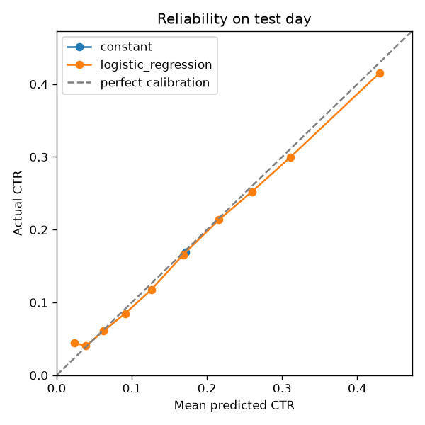

# CTR Prediction Pipeline

An end-to-end click-through-rate (CTR) prediction system built on public ad data. It covers the whole lifecycle, not just the model: time-aware evaluation, a served prediction API, scheduled retraining with Airflow, and monitoring for drift.

> 🚧 **Work in progress.** Phases 0 and 1 are done: the baseline reaches a test AUC of 0.736 and normalised entropy of 0.881 (see [results](#results)). See the [roadmap](#roadmap) for what's next.

## Why

In programmatic advertising, every bid starts with one question: *how likely is this impression to be clicked?* A CTR model has to be well calibrated, because its probabilities feed straight into bid prices. It also has to answer in a few milliseconds and keep up as traffic shifts from day to day. This project builds that system in the open, on public data.

## Data

[Avazu Click-Through Rate Prediction](https://www.kaggle.com/competitions/avazu-ctr-prediction): about 40M mobile ad impressions over 10 days (21–30 October 2014), with hourly timestamps and 21 anonymised categorical features.

Only the labelled `train.gz` file is used. It's split **by day, not at random**: days 1–8 train, day 9 validation, day 10 test. This matches production, where a model trained on the past is scored on the future.

## Roadmap

- [x] **0. Scaffold:** packaging with `uv`, lint, tests, CI on synthetic data, data download
- [x] **1. Baseline:** hashed logistic regression; log loss, AUC, normalised entropy and calibration
- [ ] **2. Better models:** LightGBM and a deep CTR model (DCN-v2), calibration, MLflow tracking
- [ ] **3. Serving:** FastAPI prediction service in Docker on Cloud Run, with a latency benchmark
- [ ] **4. Pipeline and monitoring:** Airflow DAG that replays the data day by day to retrain and evaluate, with drift checks
- [ ] **5. Bidding simulation:** turn predicted CTR into bids under a daily budget and compare clicks per £ with a flat bid
- [ ] **6. Write-up:** architecture diagram, results and lessons learned

## Quickstart

Requires [uv](https://docs.astral.sh/uv/) and Python 3.11+.

```bash
uv sync                  # install the package and dev tools
uv run pytest            # run tests on synthetic data, no download needed
uv run ruff check .      # lint
```

Get the real data (needs a Kaggle account, the competition rules accepted, and an API token in `~/.kaggle/kaggle.json`):

```bash
uv sync --extra data
uv run python scripts/download_avazu.py
```

## Baseline (phase 1)

```bash
uv run python -m ctr.train_baseline --data data/raw/train.gz
```

By default this samples 5% of rows (about 2M) from across all 10 days; `--sample-frac 1` uses everything. Every categorical value is one-hot encoded with the hashing trick into 2²⁰ columns, plus hour-of-day and day-of-week. The regularisation strength `C` is chosen on the validation day and results are reported on the test day, against a constant predictor that always outputs the training click rate. Output goes to `reports/baseline/`: `metrics.json`, `results.md` and a reliability plot.

**Metrics**

| Metric | What it measures | Good |
| --- | --- | --- |
| Log loss | Accuracy of the predicted probabilities | Lower |
| Normalised entropy | Log loss divided by the entropy of the training click rate ([He et al., 2014](https://research.facebook.com/publications/practical-lessons-from-predicting-clicks-on-ads-at-facebook/)). 1.0 = no better than the constant predictor | Lower |
| AUC | How well the model ranks clicks above non-clicks | Higher |
| Calibration ratio | Mean predicted CTR ÷ actual CTR | Close to 1 |
| ECE | Expected calibration error: average gap between predicted and actual CTR across 10 equal-count prediction bins | Lower |

Calibration matters because the predicted probability sets the bid price: a model that ranks well but predicts 2× the real CTR overbids on everything.

### Results

A 5% random sample of the Avazu train file (2,021,339 impressions): 1,618,782 to train on (21–28 October 2014), 191,306 to validate on (29 October) and 211,251 to test on (30 October). The test-day click rate is 16.95%.

| Model | Log loss | Normalised entropy | AUC | Calibration ratio | ECE |
| --- | ---: | ---: | ---: | ---: | ---: |
| Constant (training CTR, 17.16%) | 0.4551 | 0.993 | 0.500 | 1.013 | 0.0021 |
| Logistic regression, C = 0.1 | **0.4038** | **0.881** | **0.736** | 1.019 | 0.0077 |



- **Logistic regression cuts log loss by 11%** against always predicting the training click rate, and ranks clicks well above chance (AUC 0.736).
- **It's well calibrated**, which matters because predictions become bids. On average it predicts 1.9% more clicks than happen. It slightly over-predicts in the highest-CTR bin and under-predicts in the lowest.
- **The constant predictor's normalised entropy is 0.993, not 1.0**, because the click rate on the test day (16.95%) differs from training (17.16%). That gap is a small example of the day-to-day drift phase 4 will monitor.
- **C was chosen on the validation day.** Validation log loss: 0.3901 (C = 0.001), 0.3836 (0.01), **0.3814 (0.1)**, 0.3895 (1.0). Weaker regularisation overfits the long tail of rare IDs.

These numbers are not comparable with the Kaggle leaderboard, which scored a different, unlabelled test file.

Reproduce: `uv run python -m ctr.train_baseline --sample-frac 0.05 --seed 0`. It takes about 25 minutes on a laptop, mostly the C = 1 fit.

<br clear="right">

## Project layout

```
src/ctr/
  schema.py          column definitions for the Avazu data
  data.py            loading, sampling and day-based train/valid/test split
  features.py        hashing-trick featuriser
  metrics.py         log loss, normalised entropy, calibration
  train_baseline.py  phase 1 training and evaluation (CLI)
  report.py          metrics.json, results table, reliability plot
  sample.py          synthetic Avazu-format data for tests and CI
scripts/
  download_avazu.py
tests/
```

## License

MIT
